<p align="center">
  <picture>
    <source media="(prefers-color-scheme: dark)" srcset="docs/banner-dark.svg">
    
  </picture>
</p>

<p align="center">
  <a href="https://proofmesh-eight.vercel.app"></a>
  
  
  
  
</p>

<h3 align="center">Sign every dataset. Hash every chunk. Trace every derivation.<br>Change one byte and ProofMesh names the chunk, the CSV lines, and every report that inherited it.</h3>

<p align="center">
  <a href="https://proofmesh-eight.vercel.app"><b>Open the live attack lab</b></a> &nbsp;·&nbsp;
  <a href="#-quick-start">Quick start</a> &nbsp;·&nbsp;
  <a href="#-the-16-attacks">The 16 attacks</a> &nbsp;·&nbsp;
  <a href="#-how-it-works">How it works</a> &nbsp;·&nbsp;
  <a href="#-trust-model">Trust model</a>
</p>

<p align="center">
  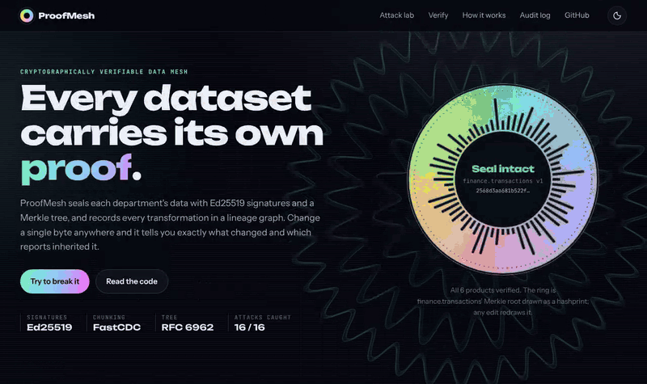
</p>

---

## 🧭 What it is

Organisations run on datasets that one team publishes and others build on. Finance publishes the ledger, Operations aggregates it into spend reports, the Executive office joins those with HR headcount for the board. When a number in the board pack is wrong, nobody can say whether the source was edited, which reports inherited the edit, or whether the report really came from the data it claims.

**ProofMesh makes every data product carry its own proof.**

| | Without ProofMesh | With ProofMesh |
|---|---|---|
| 🔏 **Who published this?** | A filename and a folder permission | An Ed25519 signature from a department key certified by a pinned mesh authority |
| 🧱 **Has it changed?** | Compare file sizes and timestamps, which an insider can fake | Content-defined chunks, each named by its SHA-256, under a signed RFC 6962 Merkle root |
| 🔎 **What changed?** | Diff two full copies, if you have both | Descend the Merkle tree: **13 comparisons find 1 altered chunk out of 42**, down to the CSV lines |
| 🕸️ **What else is affected?** | Ask around | A signed lineage graph lists every downstream product, with the path |
| 🧾 **Can I prove it to an auditor?** | Screenshots | An offline evidence bundle anyone can verify with the authority's public key |

<details>
<summary><b>Glossary</b> (data product, manifest, Merkle root, lineage, tainted…)</summary>

| Term | Meaning here |
|---|---|
| **Domain** | A department (finance, hr, operations…) with its own signing key, certified by the mesh authority. |
| **Data product** | A named, versioned dataset a domain publishes, governed by a signed data contract. |
| **Data contract** | Schema, quality rules, readers, writers and permitted purposes, signed by the owner at registration. |
| **Manifest** | The signed record of one product version: chunk list, Merkle root, contract, quality report, lineage, log anchor. |
| **Chunk** | A content-defined slice of the file (FastCDC), stored under the SHA-256 of its bytes. |
| **Merkle root** | One hash that commits to every chunk in order. Any edit changes it. |
| **Lineage** | Which inputs (pinned by Merkle root) and which transformation (pinned by code hash) produced a product. |
| **VERIFIED / TAINTED / TAMPERED / INVALID / ERASED** | Intact · intact but built on compromised data · bytes changed · signatures, records or history don't check out · recorded in the audit log but deleted from the registry. |

</details>

## 🖼️ See it

<table>
<tr>
<td width="50%">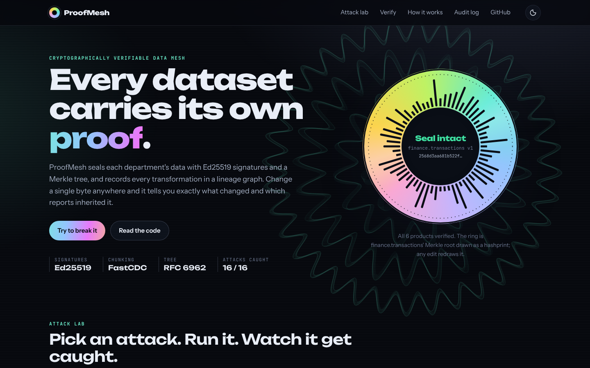</td>
<td width="50%">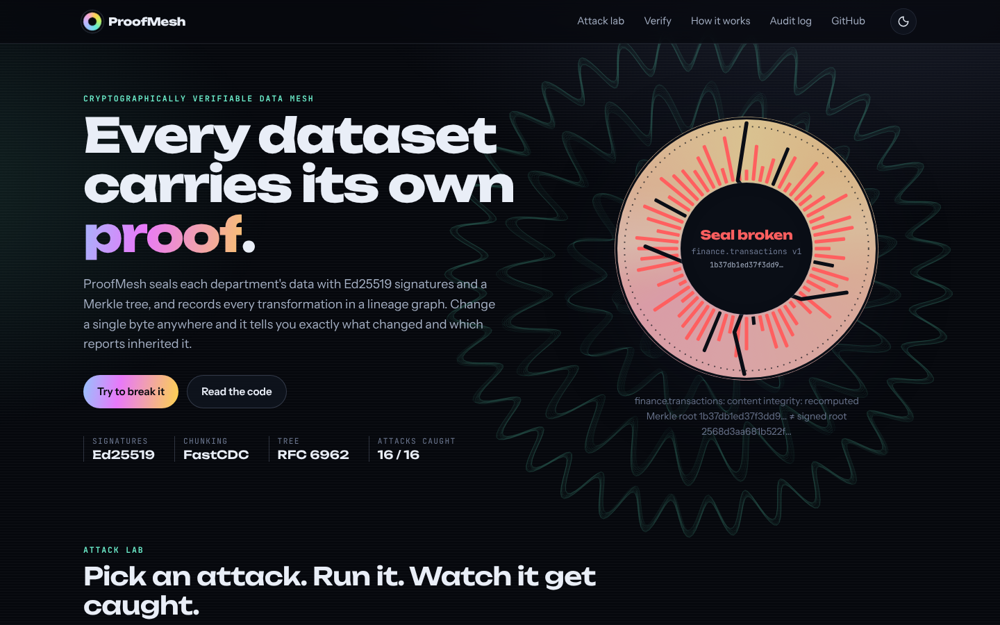</td>
</tr>
<tr>
<td align="center"><b>Seal intact.</b> The ring is the ledger's real Merkle root drawn as a hashprint: 64 bars, one per hex digit.</td>
<td align="center"><b>One transaction edited.</b> Avalanche: almost every digit of the recomputed root differs, so the seal cracks.</td>
</tr>
</table>

<p align="center">
  <picture>
    <source media="(prefers-color-scheme: dark)" srcset="docs/screenshots/lab-dark.png">
    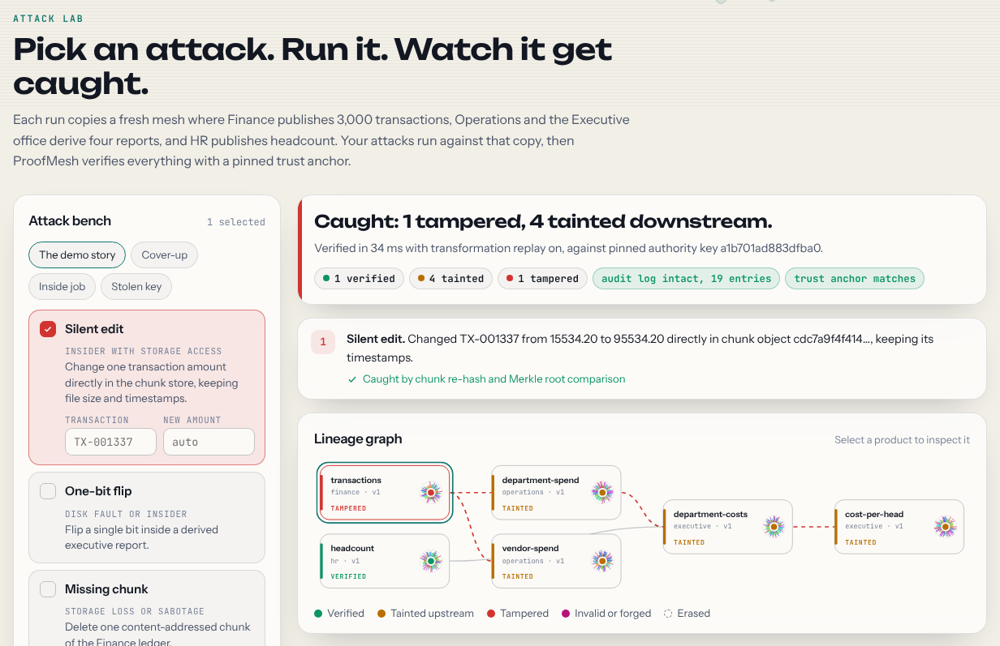
  </picture>
  <br><sub><b>The attack lab.</b> Pick any of 16 attacks, run them against a throwaway copy of the mesh, and watch the lineage graph light up. 1 tampered, 4 tainted downstream.</sub>
</p>

<p align="center">
  <picture>
    <source media="(prefers-color-scheme: dark)" srcset="docs/screenshots/merkle-dark.png">
    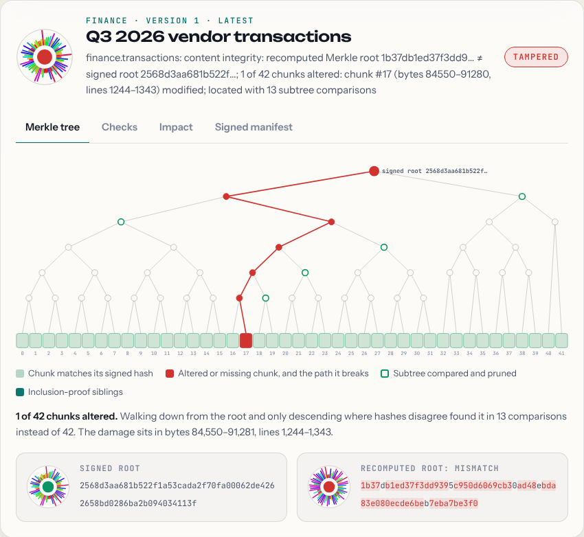
  </picture>
  <br><sub><b>Localisation, visualised.</b> Red nodes disagree with the signed tree, green rings are subtrees compared once and pruned. Click any chunk for its inclusion proof.</sub>
</p>

<table>
<tr>
<td width="50%">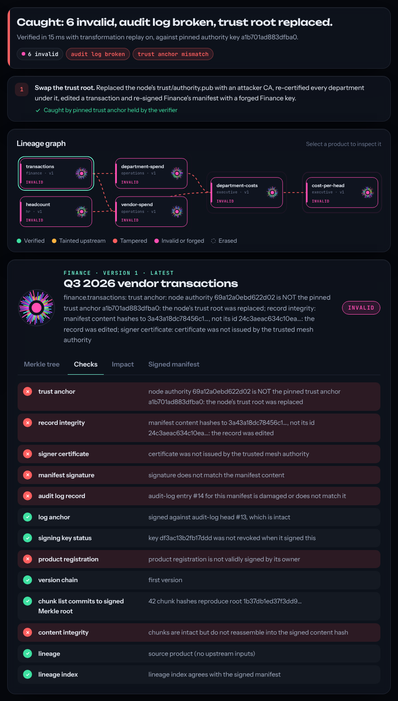</td>
<td width="50%">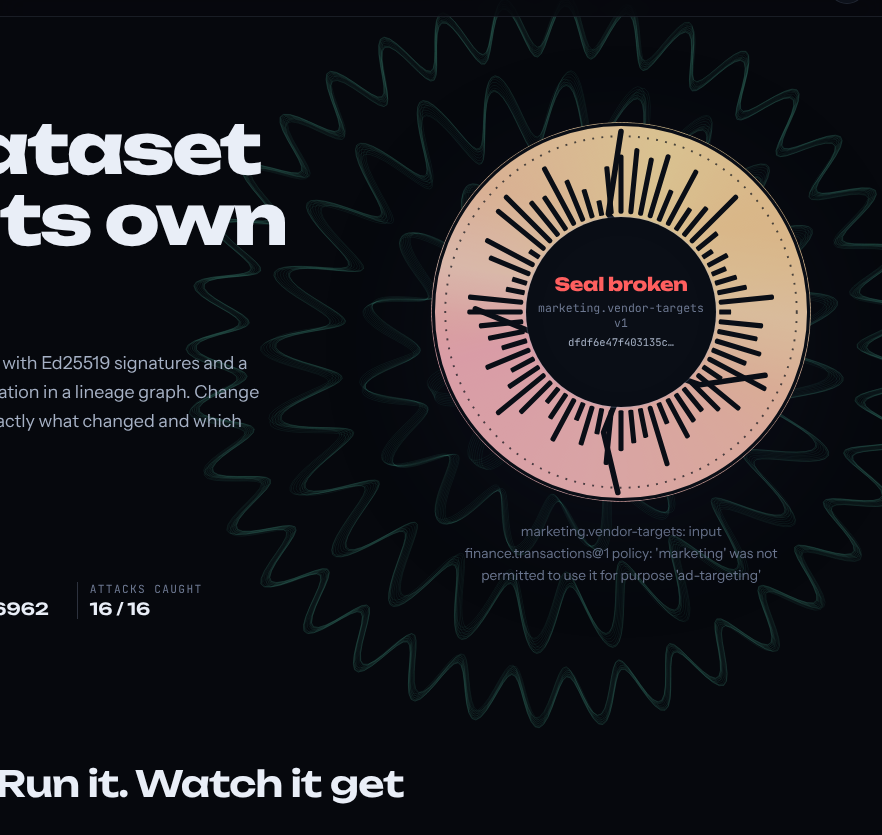<br><br>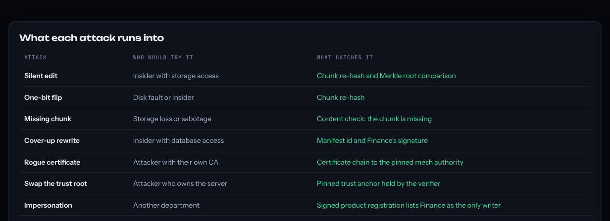</td>
</tr>
<tr>
<td align="center"><b>Inside job.</b> The attacker owns the server, swaps its trust root and re-signs everything. The verifier's pinned anchor still says no.</td>
<td align="center"><b>Three at once.</b> An erased report shows up as a ghost, a rewritten log entry breaks the hash chain, and a policy bypass is refused.</td>
</tr>
</table>

<p align="center">
  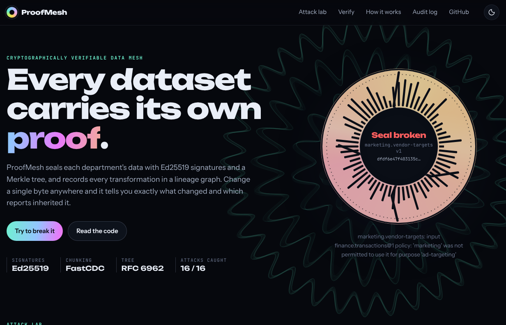
  <br><sub><b>Verify it yourself.</b> Edit the ledger in a spreadsheet and drop it back: ProofMesh shows the exact characters you changed. Ask whether Marketing may use Finance data for ad targeting. Tamper with an evidence bundle and watch it fail offline.</sub>
</p>

<p align="center">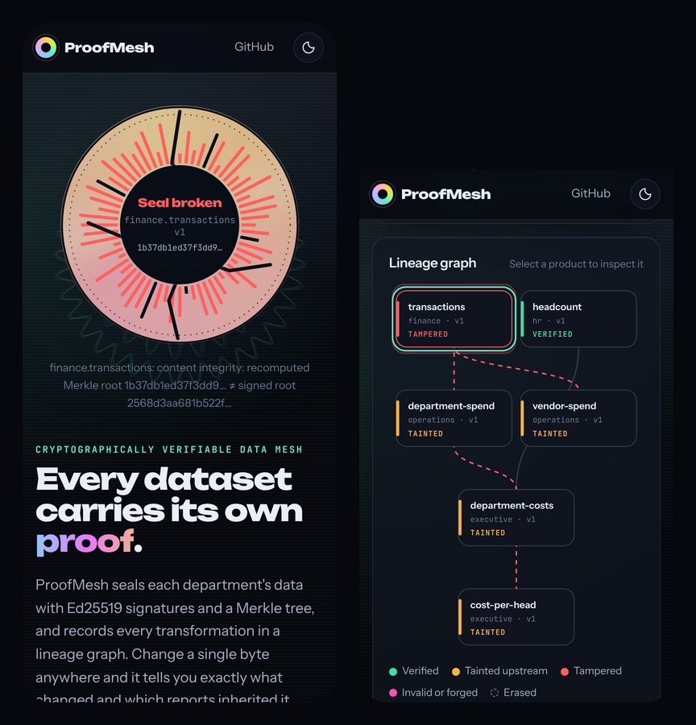</p>

## 🔬 How it works

<p align="center">
  <picture>
    <source media="(prefers-color-scheme: dark)" srcset="docs/pipeline-dark.svg">
    
  </picture>
</p>

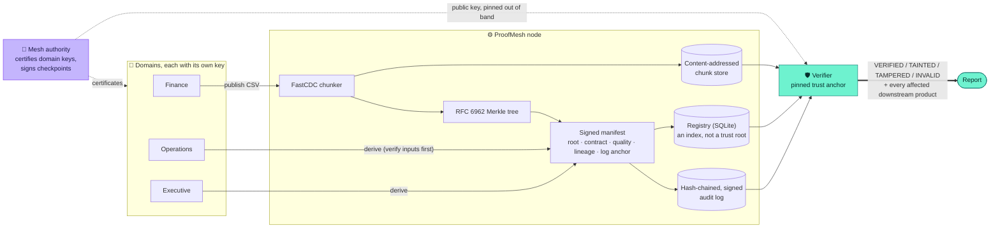

### What one verification checks

Every product version goes through all of these, in order. Each check is reported with its own verdict and detail.

| # | Check | Catches |
|---|---|---|
| 1 | **Trust anchor**: the node's authority key equals the key the verifier pinned | A server whose trust root was swapped |
| 2 | **Record integrity**: the manifest hashes to its id and matches its registry row | Edited manifests |
| 3 | **Signer certificate**: the domain key chains to the pinned authority | Rogue certificate authorities |
| 4 | **Manifest signature**: Ed25519, domain-separated (`proofmesh/manifest/v1\0…`) | Forged or altered manifests |
| 5 | **Audit-log record + log anchor**: publication is in the hash chain, signed against an intact head | Manifests slipped in behind ProofMesh's back, truncated logs |
| 6 | **Signing key status**: the key wasn't revoked *earlier in the log* than this signature | Stolen keys used after revocation (ordered by log sequence, not forgeable timestamps) |
| 7 | **Rollback protection**: every version the log recorded still exists | Deleting a newer version to serve stale data |
| 8 | **Registration**: owner-signed contract, owner, authorised writer | Impersonation, loosened contracts |
| 9 | **Version chain**: v*n* points at v*n−1*'s manifest | Spliced histories |
| 10 | **Content**: re-hash every chunk, rebuild the Merkle root, localise the damage to bytes and CSV lines | Silent edits, bit flips, missing chunks |
| 11 | **Lineage**: each input still verifies, still matches the pinned root, and was used for a purpose its contract permits | Tainted inputs, policy bypass |
| 12 | **Replay** (optional): re-run the declared transformation on the pinned inputs and compare roots | A department publishing numbers its code could not have produced |

## 🎬 The demonstration

`proofmesh demo` runs the story end to end, exactly as specified: Finance publishes a verified dataset, other departments derive reports, an insider secretly edits the source, Merkle verification catches it, and the lineage graph lists every affected report.

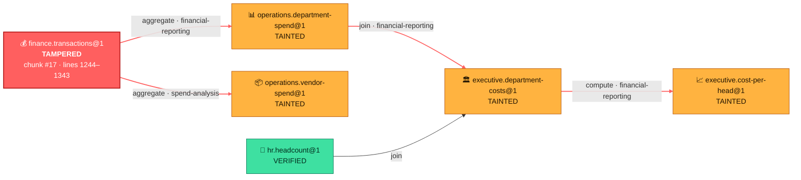

<details open>
<summary><b>Terminal output</b> (abridged; full run in <a href="docs/demo-output.txt">docs/demo-output.txt</a>)</summary>

```text
━━ 5. An insider secretly edits the source data in storage ━━━━━━━━━━━━━━━━━
  TX-001337 amount changed 15534.20 → 95534.20 inside chunk object cdc7a9f4f414… (same size, timestamps restored)

━━ 6. Ask ProofMesh to verify finance.transactions ━━━━━━━━━━━━━━━━━━━━━━━━━
  TAMPERED finance.transactions@1
  signed Merkle root     2568d3aa681b522f1a53cada2f70fa00062de4262658bd0286ba2b094034113f
  recomputed Merkle root 1b37db1ed37f3dd9395c950d6069cb30ad48ebda83e080ecde6beb7eba7be3f0
  ✗ chunk #17 modified: bytes 84550–91280, CSV lines 1244–1343
  located by descending the Merkle tree: 13 subtree comparisons for 42 chunks
  manifest signature still valid → Finance really published the original; the stored bytes changed

━━ 7. Blast radius: every downstream product derived from the tampered data
  ⚠ operations.vendor-spend@1 (owner: operations)  via finance.transactions@1 → operations.vendor-spend@1
  ⚠ operations.department-spend@1 (owner: operations)  via finance.transactions@1 → operations.department-spend@1
  ⚠ executive.department-costs@1 (owner: executive)  via … → operations.department-spend@1 → executive.department-costs@1
  ⚠ executive.cost-per-head@1 (owner: executive)  via … → executive.department-costs@1 → executive.cost-per-head@1
  ✓ hr.headcount@1 unaffected

━━ 9. The insider rewrites the manifest to match the edited bytes ━━━━━━━━━━
  INVALID  finance.transactions: record integrity: manifest content hashes to 5aa308dc…, not its id 2e80cb07…;
           manifest signature: signature does not match the manifest content; audit log record: entry #14 does not match
```

</details>

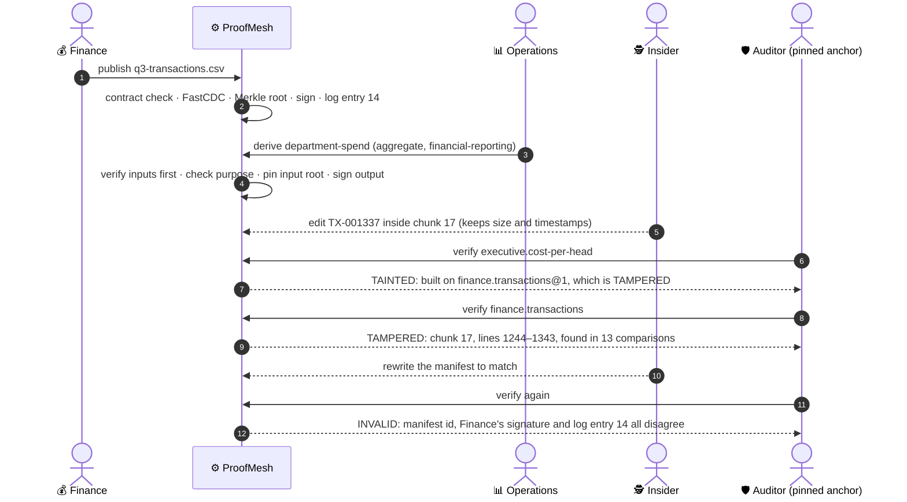

### Why 13 comparisons

The Merkle tree lets a verifier compare subtree hashes from the root down and only descend where they disagree. For one altered chunk among *n*, that's about 2·log₂(*n*) comparisons instead of *n*.

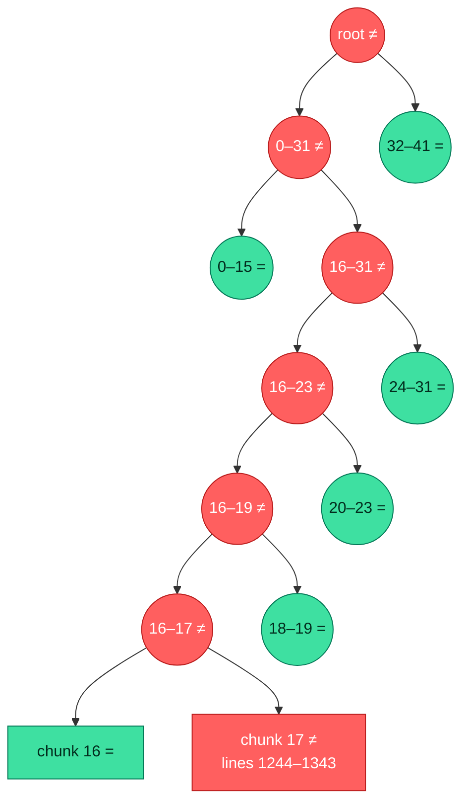

## 💥 The 16 attacks

Every one of these runs in the [live lab](https://proofmesh-eight.vercel.app) (click a name to run it there), in `proofmesh lab <attack>`, and in [`tests/test_lab.py`](tests/test_lab.py). All 16 are caught. Combine them with `?run=edit,erase-report,tamper-log`.

| | Attack | Who would try it | What they do | Caught by | Verdict |
|:-:|---|---|---|---|---|
| ✏️ | [**Silent edit**](https://proofmesh-eight.vercel.app/?run=edit) | Insider with storage access | Change one amount directly in the chunk store, keeping size and timestamps | Chunk re-hash and Merkle root | 🟥 `TAMPERED` + 4 `TAINTED` |
| ⚡ | [**One-bit flip**](https://proofmesh-eight.vercel.app/?run=bitflip) | Disk fault or insider | Flip one bit in a derived executive report | Chunk re-hash | 🟥 `TAMPERED` |
| 🕳️ | [**Missing chunk**](https://proofmesh-eight.vercel.app/?run=delete-chunk) | Storage loss or sabotage | Delete one content-addressed chunk | Content check | 🟥 `TAMPERED` |
| 🧽 | [**Cover-up rewrite**](https://proofmesh-eight.vercel.app/?run=rewrite-manifest) | Insider with database access | Edit the data, then rewrite the manifest so its hashes match | Manifest id and Finance's signature | 🟪 `INVALID` |
| 🪪 | [**Rogue certificate**](https://proofmesh-eight.vercel.app/?run=rogue-ca) | Attacker with their own CA | Re-sign forged data with a key from the attacker's authority | Certificate chain to the pinned authority | 🟪 `INVALID` |
| 🗝️ | [**Swap the trust root**](https://proofmesh-eight.vercel.app/?run=trust-root) | Attacker who owns the server | Replace `authority.pub`, re-certify every domain, re-sign forged data | Pinned trust anchor held by the verifier | 🟪 all `INVALID` |
| 🎭 | [**Impersonation**](https://proofmesh-eight.vercel.app/?run=impersonate) | Another department | Operations re-signs Finance's dataset with its own valid key | Signed registration names Finance as sole writer | 🟪 `INVALID` + 👻 original `ERASED` |
| 📜 | [**Loosen the contract**](https://proofmesh-eight.vercel.app/?run=loosen-contract) | Database administrator | Add `ad-targeting` to Finance's permitted purposes | Owner-signed product registration | 🟪 `INVALID` + 4 `TAINTED` |
| 🙈 | [**Hide the lineage**](https://proofmesh-eight.vercel.app/?run=hide-lineage) | Insider shrinking the blast radius | Edit the data, delete lineage index rows | Impact analysis reads signed manifests, not the index | 🟥 `TAMPERED` + 4 `TAINTED` |
| 🧮 | [**Forged derivation**](https://proofmesh-eight.vercel.app/?run=forge-report) | Department publishing bad numbers | Publish altered figures, claiming a verified `aggregate` | Replay of the declared transformation | 🟪 `INVALID` |
| 🗑️ | [**Erase a report**](https://proofmesh-eight.vercel.app/?run=erase-report) | Insider hiding evidence | Delete the board report from the registry | Hash-chained, signed audit log | 👻 `ERASED` |
| ⏪ | [**Rollback**](https://proofmesh-eight.vercel.app/?run=rollback) | Insider serving stale data | Delete Finance's corrected v2 so consumers get v1 | Audit log records every version | 🟪 `INVALID` + 👻 `ERASED` |
| 📝 | [**Rewrite history**](https://proofmesh-eight.vercel.app/?run=tamper-log) | Database administrator | Edit an audit-log entry | Hash chain and per-entry signatures | ⛓️ log broken |
| ✂️ | [**Truncate the log**](https://proofmesh-eight.vercel.app/?run=truncate-log) | Database administrator | Delete the newest log entries | Manifest log records and the authority-signed checkpoint | 🟪 `INVALID`, ⛓️ log broken |
| 🥷 | [**Stolen key**](https://proofmesh-eight.vercel.app/?run=stolen-key) | Thief with a revoked key | Publish v2 of the ledger with Finance's revoked key | Revocation ordered by log sequence, not timestamps | 🟪 `INVALID` |
| 🚫 | [**Policy bypass**](https://proofmesh-eight.vercel.app/?run=policy-bypass) | Department ignoring its contract | Marketing publishes an ad-targeting list from Finance data | Purpose re-checked against the signed contract | 🟪 `INVALID` |

## 🛡️ Trust model

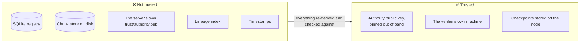

**ProofMesh treats its own database as hostile.** The registry, chunk store and lineage index are conveniences; anything a verifier relies on is signed or hash-linked, and the only thing it needs to trust is the authority's public key, pinned with `--trust-anchor` or `PROOFMESH_TRUST_ANCHOR`.

What it does **not** claim: if an attacker holds the mesh authority's *private* key, or deletes the whole audit log *and* every off-node checkpoint, they can rewrite history. Keep the authority key offline (or in a KMS), store `proofmesh checkpoint` output somewhere the node can't write, and rotate any domain key you suspect with `proofmesh domain revoke`.

### Loopholes closed in 1.0

The first version already caught edits, forged manifests and tainted lineage. 1.0 hardens everything around it:

| Loophole in the MVP | Fix in 1.0 |
|---|---|
| A server owner could replace `trust/authority.pub` and re-sign everything | Verifiers **pin** the authority key (full key or key id) and report a mismatch on every product |
| Deleting a newer version silently rolled consumers back | Every publication is in the signed log; a version the log knows about but the registry lacks is **rollback** / **ERASED** |
| A manifest inserted straight into SQLite looked legitimate | Manifests carry a **log anchor** and must have a matching signed log record |
| Truncating the tail of the log left a valid-looking chain | Authority-signed **checkpoints** commit to a log position and head hash |
| No way to retire a stolen key | **Key rotation and revocation**, ordered by log sequence so back-dated signatures don't help |
| Contracts and ownership lived in an editable table | Products are registered with an **owner-signed registration**; edits make the product INVALID |
| Log entries were hash-chained but unsigned | Each entry is **signed by the acting domain** and records its key id |
| Evidence bundles carried the key used to check them | Bundles carry only a key id; `verify-bundle` needs the **pinned** key |
| The node API accepted writes from anyone | **Bearer tokens** per domain (stored hashed), an admin token from `init`, and reads of data checked against the contract's readers |
| Keys sat unencrypted on disk | Keys encrypt with `PROOFMESH_KEY_PASSPHRASE`, files are `0600` |
| Hostile filenames, duplicate columns and ragged CSV rows were accepted | Filenames are sanitised; contracts reject duplicate headers and rows with the wrong number of fields |
| Unbounded uploads; no browser hardening | Size limits, CSP, `X-Frame-Options: DENY`, `nosniff`, `no-referrer` |

## 🚀 Quick start

```bash
git clone https://github.com/harshh-2505/ProofMesh && cd ProofMesh
pip install -e ".[server,dev]"

proofmesh demo                 # the end-to-end story in your terminal
proofmesh lab --list           # the 16 attacks
proofmesh lab trust-root       # run one against a throwaway mesh
proofmesh serve --lab-only     # the web lab at http://127.0.0.1:8000
pytest -q                      # 124 tests
```

### Use it on your own data

```bash
export PROOFMESH_ROOT=./node
proofmesh init                                   # prints the trust anchor and the admin token path
export PROOFMESH_TRUST_ANCHOR=<key id printed by init>

proofmesh domain add finance --description "Corporate Finance"      # prints finance's API token
proofmesh product register finance.transactions --owner finance --contract contract.json
proofmesh publish finance.transactions q3.csv
proofmesh derive operations.vendor-spend -i finance.transactions -t aggregate \
    -p 'group_by=["vendor"]' -p 'metrics=[{"fn":"sum","column":"amount","as":"total_spend"}]' \
    --purpose spend-analysis

proofmesh verify operations.vendor-spend --replay -v   # exit code 2 unless VERIFIED
proofmesh audit --checkpoint cp.json                   # the whole mesh plus the audit log
proofmesh lineage finance.transactions                 # upstream and downstream
```

<details>
<summary><b>Full CLI reference</b></summary>

| Command | What it does |
|---|---|
| `init` | Create a node: authority key, trust anchor, admin token |
| `domain add / list / rotate / revoke` | Manage departments and their keys |
| `token issue <principal>` | Issue an API bearer token |
| `product register / list` | Register a product with an owner-signed contract |
| `publish <product> <file>` | Publish a new version (contract-checked, chunked, signed, logged) |
| `derive <product> -i … -t …` | Derive from verified inputs with a registered transformation |
| `verify <product> [--replay] [-v]` | Verify a version and its full history |
| `verify-file <product> <file>` | Check a copy you received against the signed manifest |
| `audit [--checkpoint cp.json]` | Verify every version plus the audit log |
| `lineage [product]` | Graph, or one product's upstream and downstream |
| `show <product>` | Print the signed manifest |
| `export <product> <out>` | Verify, then write the data |
| `bundle <product> <out>` / `verify-bundle <file> --authority-key …` | Offline evidence |
| `prove <product> <index>` | Merkle inclusion proof for one chunk |
| `log` | Show and verify the audit log |
| `checkpoint [--out]` | Authority-signed log checkpoint to keep off the node |
| `transforms` | List registered transformations |
| `lab [attacks…] [--list]` | Run attacks against a throwaway demo mesh |
| `demo` | The end-to-end demonstration |
| `serve [--lab-only]` | REST API and web UI |

Global flags: `--root` (or `PROOFMESH_ROOT`), `--trust-anchor` (or `PROOFMESH_TRUST_ANCHOR`).

</details>

<details>
<summary><b>REST API</b></summary>

`proofmesh serve` runs FastAPI with interactive docs at `/docs`.

**Lab** (`/api/lab/*`, stateless, public, what the live site uses):

| Method | Route | Purpose |
|---|---|---|
| GET | `/api/lab/catalog` | The 16 attacks |
| POST | `/api/lab/run` | `{"attacks": [{"id": "edit", "params": {"txn": "TX-000100"}}]}` → full snapshot: verdicts, graph, reports, manifests, audit log |
| GET | `/api/lab/run?attacks=edit,trust-root` | The same, with default parameters (shareable) |
| GET | `/api/lab/data/{product}` | Pristine data |
| POST | `/api/lab/verify-copy/{product}` | Check an uploaded copy, with line-level diff |
| GET | `/api/lab/policy?consumer=&purpose=` | Ask the policy engine |
| GET / POST | `/api/lab/bundle/{product}` · `/api/lab/verify-bundle` | Evidence bundles |
| GET | `/api/lab/proof/{product}/{index}` | Merkle inclusion proof |

**Node** (`/api/node/*`, a persistent node at `$PROOFMESH_ROOT`; off when `PROOFMESH_MODE=lab`). Writes and data reads need `Authorization: Bearer <token>`.

| Method | Route | Auth |
|---|---|---|
| GET | `/api/node/overview`, `/products`, `/lineage`, `/audit`, `/log` | public (signed metadata only) |
| POST | `/api/node/domains`, `/domains/{name}/rotate`, `/domains/{name}/revoke` | admin |
| POST | `/api/node/products` | owner or admin |
| POST | `/api/node/products/{id}/versions`, `/derive` | owning domain |
| GET | `/api/node/products/{id}/manifest`, `/verify`, `/proof/{i}`, `/bundle` | public |
| GET | `/api/node/products/{id}/data` | a reader named in the contract; **409** if it doesn't verify |
| GET | `/api/node/checkpoint` | admin |

</details>

<details>
<summary><b>Data contract format</b></summary>

```json
{
  "schema": {"format": "csv", "columns": [
    {"name": "txn_id", "type": "string", "required": true},
    {"name": "amount", "type": "decimal", "required": true}]},
  "quality_rules": [
    {"id": "txn-id-unique", "type": "unique", "column": "txn_id"},
    {"id": "amount-positive", "type": "range", "column": "amount", "min": 0.01},
    {"id": "currency", "type": "allowed_values", "column": "currency", "values": ["USD"], "severity": "warn"}],
  "access_policy": {"readers": ["*"], "writers": ["finance"]},
  "permitted_purposes": ["audit", "financial-reporting", "spend-analysis"],
  "classification": "confidential"
}
```

Column types: `string`, `integer`, `decimal`, `date`, `boolean`. Rule types: `not_null`, `unique`, `range`, `allowed_values`, `regex`, `row_count`. A rule with severity `error` blocks publishing; `warn` is recorded in the signed quality report. `{"schema": {"format": "binary"}}` gives integrity and lineage without schema checks.

</details>

## ☁️ Deploy your own

[](https://vercel.com/new/clone?repository-url=https%3A%2F%2Fgithub.com%2Fharshh-2505%2FProofMesh)

The hosted site is the **attack lab**: `app.py` sets `PROOFMESH_MODE=lab` and exposes the FastAPI app. Each request copies a deterministic demo mesh (fixed seed, fixed clock, so every serverless instance builds byte-identical manifests) into `/tmp`, applies your attacks, verifies with the pinned anchor and replay on, and throws the copy away. No database, no storage, no secrets. A run, attacks plus full verification, takes well under a second.

For a real deployment, run `proofmesh serve` on a machine with a persistent disk and keep the authority key offline.

## 🗂️ Project layout

```
proofmesh/
  canonical.py   canonical JSON and hashing
  crypto.py      Ed25519 keys, certificates, domain-separated signatures, encrypted key files
  chunking.py    FastCDC content-defined chunking
  merkle.py      RFC 6962 Merkle tree, inclusion proofs, change localisation
  store.py       content-addressed chunk store
  contract.py    schema, quality rules, CSV shape checks, access policy, sticky purposes
  transforms.py  deterministic, replayable transformations (pinned by code hash)
  db.py          SQLite registry, key table, API tokens, hash-chained signed audit log
  mesh.py        register, publish, derive, rotate, revoke, checkpoint, bundles
  verify.py      verification engine, impact analysis, log and bundle verification
  lineage.py     lineage graph views
  lab.py         the 16 attacks and the stateless sandbox
  demo.py        the demonstration scenario
  api.py, cli.py, web/   REST API, CLI, the lab UI (no framework, strict CSP)
app.py           Vercel entrypoint
tests/           124 tests: units, every tamper scenario, hardening, all 16 lab attacks, API, CLI
docs/            artwork (regenerate with docs/tools/make_art.py), screenshots, demo output
```

## 🧠 Design notes

- **The registry is an index, not a trust root.** Everything that matters is signed or hash-linked, so tampering with SQLite is detected rather than believed.
- **Signatures are domain-separated** (`context ‖ 0x00 ‖ canonical JSON`), so a signature over a log entry can't be replayed as a manifest.
- **Leaf and node prefixes** (0x00 / 0x01, as in RFC 6962) prevent second-preimage attacks on the tree. Inclusion proofs verify one chunk with O(log n) hashes.
- **Content-defined chunking** means inserting a row disturbs only the chunks around it, so localisation stays precise and storage deduplicates across versions.
- **Verify before use.** `read` and `derive` refuse data that doesn't verify, and every derived manifest pins its inputs by Merkle root.
- **Purposes are sticky.** A derived product can never permit a purpose its inputs don't allow.
- **Order by the log, not the clock.** Revocation and rollback decisions use log sequence numbers, which an attacker can't back-date.

## 🛣️ Roadmap

1. One node per department, keys in an HSM or KMS, signed manifests replicated between nodes.
2. Threshold (multi-party) mesh authority.
3. Publish checkpoints to an external transparency log or timestamping service.
4. Streaming chunking for multi-GB files; Parquet-aware chunking by row group.
5. FlowGuard integration: use ProofMesh lineage as evidence for where sensitive data may flow.

---

<p align="center"><sub>MIT licensed. Built to be broken: if you find an attack the lab doesn't catch, open an issue.</sub></p>
