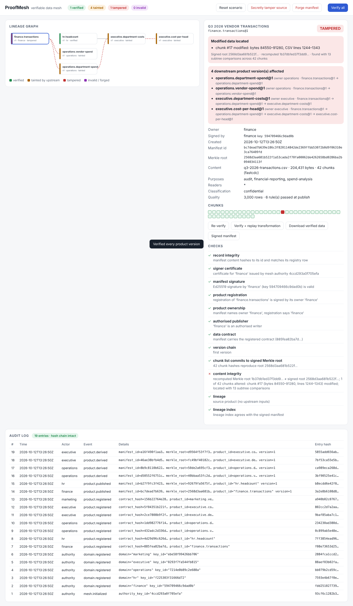

# ProofMesh

**A cryptographically verifiable data mesh.** Departments publish datasets as *data products*. Each version comes with a signed manifest: the data contract, a Merkle tree over content-addressed chunks, and the full transformation lineage. Any consumer can check where a dataset came from, whether any byte of it or of anything upstream was modified, and, when something was modified, which downstream products are affected.

Think of food packaging: a tamper-evident seal, an ingredient list, the producer's identity, and a record of every factory that processed it. ProofMesh does the same for organisational data.

```
Department publishes data
        ↓
ProofMesh chunks it, hashes every chunk, builds a Merkle tree, checks the contract and signs a manifest
        ↓
Another department transforms it (inputs verified first, purpose checked against the contract)
        ↓
The transformation is signed into the output's manifest and added to the lineage graph
        ↓
A consumer verifies the complete history, from the source data to the report in hand
```

---

## Quick start

```bash
pip install -e ".[dev]"          # Python 3.10+; runtime dependency: cryptography
proofmesh demo                   # the end-to-end tamper-detection story, in the terminal
proofmesh serve --demo           # the same story in a web UI at http://127.0.0.1:8000
python -m pytest                 # 90 tests
```

## The demonstration

`proofmesh demo` (output in [`docs/demo-output.txt`](docs/demo-output.txt)) runs this scenario:

| Step | What happens | What ProofMesh shows |
|---|---|---|
| 1 | The mesh authority certifies five departments: finance, hr, operations, executive, marketing | Each department gets its own Ed25519 key |
| 2 | **Finance** publishes `finance.transactions` (3,000 rows, 42 chunks). HR publishes `hr.headcount` | Signed manifests with Merkle roots |
| 3 | **Operations** derives `vendor-spend` and `department-spend`. **Executive** joins department spend with HR headcount, then computes `cost-per-head` for the board | A four-level lineage graph |
| 4 | Marketing tries to use finance data for `ad-targeting` | **Denied**: that purpose isn't in the contract |
| 5 | Baseline audit | All 6 products **VERIFIED** |
| 6 | An insider **secretly edits** one transaction (TX-001337: 15534.20 → 95534.20) directly in storage. The file size stays the same and the timestamps are restored | |
| 7 | Verify `finance.transactions` | **TAMPERED**. The recomputed Merkle root ≠ the signed root. The change is pinned to *chunk #17, bytes 84550–91280, CSV lines 1244–1343*, found with 13 subtree comparisons instead of 42 |
| 8 | Blast radius | All 4 downstream products are listed with their paths, e.g. `finance.transactions@1 → operations.department-spend@1 → executive.department-costs@1 → executive.cost-per-head@1`. `hr.headcount` is correctly reported as **unaffected** |
| 9 | Consumers | The board report verifies as **TAINTED**. Reading it and deriving from the tampered source are both **blocked** |
| 10 | The insider rewrites the stored manifest so its hashes match the edited bytes | **INVALID**: the manifest no longer hashes to its id and Finance's signature fails. Downstream is still flagged |



---

## How the MVP requirements map to the code

| Requirement | Implementation |
|---|---|
| Departments register data products | `ProofMesh.register_domain` issues each department a key and an authority-signed certificate. `register_product` records a product registration signed by its owner, including its **data contract** (schema, quality rules, access policy, permitted purposes, classification). See `mesh.py` and `contract.py` |
| A signed manifest for each product | `mesh.py::_record` produces a canonical-JSON manifest (product, version, previous version, contract, content, quality report, lineage, signer) signed with Ed25519 over a domain-separated context. The manifest id is the SHA-256 of the canonical manifest |
| Files are divided into chunks and hashed | `chunking.py` does FastCDC **content-defined chunking**, so an insertion only disturbs nearby chunks. `store.py` keeps a **content-addressed** chunk store (`objects/ab/cdef…`) with de-duplication across versions. `merkle.py` builds an RFC 6962-style **Merkle tree** with inclusion proofs and top-down change localisation |
| Transformations are recorded in a lineage graph | `derive` runs a registered deterministic transformation (`transforms.py`: filter, select, aggregate, join, compute). `derive_external` records one that ran elsewhere, such as a notebook or a Spark job. Inputs are pinned by manifest id and Merkle root; the code hash, parameters, purpose and executor are signed into the output manifest. A SQL index (`lineage_edges`, `transformations`) supports fast queries. `lineage.py` provides graph views |
| Integrity is verified and downstream impact shown | `verify.py::Verifier` runs the checks below recursively over the full upstream history. For a compromised version it walks the lineage built from *signed manifests* to list every affected downstream product version with its path. `audit()` verifies the whole mesh plus the hash-chained audit log |

### What verification checks

For a product version, and recursively for every ancestor:

1. **Record integrity**: the stored manifest hashes to its id.
2. **Signer certificate**: it chains to the pinned mesh authority key (`trust/authority.pub`).
3. **Manifest signature**: Ed25519 by the certified key.
4. **Product registration and ownership**: the registration is signed by the owner, the signer is an authorised writer, and the manifest carries the registered contract unchanged.
5. **Version chain**: version *n* links to an intact version *n − 1*.
6. **Content**: every chunk is re-read and re-hashed, and the Merkle root is recomputed and compared with the signed root. Changes are localised to chunk, byte range and CSV lines, and the contract's quality rules are re-evaluated.
7. **Lineage**: each input exists and matches the Merkle root pinned at derivation time. Each input is recursively verified, and the declared purpose and reader permissions are re-checked against the input's contract.
8. **Lineage index**: the SQL index agrees with the signed manifests. A disagreement is a warning; impact analysis always uses the signed manifests.
9. **Replay** (`--replay`): registered transformations are re-executed and must reproduce the signed output byte for byte.

**Statuses**, worst first:

| Status | Meaning |
|---|---|
| `INVALID` | The manifest or its provenance claims are forged or broken |
| `TAMPERED` | The manifest is authentic but the stored bytes changed |
| `TAINTED` | This product is intact but something upstream is compromised |
| `VERIFIED` | Every check passed, including the full upstream history |

### Threat model: what is detected

| Attack | Detected by | Test |
|---|---|---|
| Edit bytes of a stored dataset (silently, keeping the same size) | Chunk re-hash plus Merkle root → `TAMPERED` | `test_secret_edit_is_detected_and_localised` |
| Flip one bit in a derived report | Same → `TAMPERED`; its descendants become `TAINTED`; unrelated products stay `VERIFIED` | `test_single_bit_flip_in_derived_product` |
| Delete a chunk | Missing object → `TAMPERED` | `test_deleted_chunk` |
| Rewrite the manifest to match the edited data | Manifest id mismatch plus invalid signature → `INVALID` | `test_rewriting_the_manifest_is_detected` |
| Re-sign with a rogue key and a rogue certificate | Certificate isn't from the pinned authority → `INVALID` | `test_resigning_with_a_rogue_key_is_detected` |
| Another department signs a Finance product | Signer isn't an authorised writer → `INVALID` | `test_other_domain_cannot_sign_for_finance` |
| Loosen a contract in the registry (e.g. add a purpose) | The owner's registration signature fails → `INVALID` | `test_contract_drift_is_detected` |
| Delete lineage rows to hide dependants | Impact analysis uses signed manifests; the index mismatch is flagged | `test_hiding_lineage_edges_does_not_hide_impact` |
| Sign a "report" whose numbers aren't what the declared transformation produces | Replay → `INVALID` | `test_replay_catches_a_forged_derivation` |
| Edit or delete audit-log entries | Hash chain plus per-entry signatures | `test_audit_log_tampering`, `test_audit_log_deletion` |
| Use data for a purpose its contract forbids, or widen a purpose downstream | Derivation refused; purposes are *sticky* | `test_purpose_and_reader_enforcement`, `test_derived_product_cannot_widen_purposes` |
| A consumer receives a modified copy out of band | `verify-file` re-chunks it and compares it with the signed root | `test_verify_received_copy` |

**Out of scope for the MVP**: a department publishing wrong data *with its own valid key*. The signature proves who published the data, not that it is correct; that is what quality rules and lineage are for. Also out of scope are compromise of the authority key and key revocation (see "Next steps").

---

## CLI

```bash
export PROOFMESH_ROOT=./node
proofmesh init
proofmesh domain add finance --description "Corporate Finance"
proofmesh product register finance.transactions --owner finance --contract contract.json
proofmesh publish finance.transactions q3.csv
proofmesh derive operations.vendor-spend -i finance.transactions -t aggregate \
    -p 'group_by=["vendor"]' -p 'metrics=[{"fn":"sum","column":"amount","as":"total_spend"}]' \
    --purpose spend-analysis
proofmesh verify operations.vendor-spend --replay -v    # exit code 2 if not VERIFIED
proofmesh audit                                         # the whole mesh plus the audit log
proofmesh lineage finance.transactions                  # upstream and downstream
proofmesh verify-file finance.transactions copy.csv     # check a copy you received
proofmesh prove finance.transactions 17                 # Merkle inclusion proof for one chunk
proofmesh export executive.cost-per-head out.csv        # verify, then write
proofmesh bundle executive.cost-per-head evidence.json  # manifest plus every ancestor's manifest
proofmesh log                                           # hash-chained audit log
```

## REST API

`proofmesh serve` runs FastAPI with interactive docs at `/docs`. The main routes:

| Method | Route | Purpose |
|---|---|---|
| GET | `/api/overview` | Domains, products, status counts, compromised products |
| POST | `/api/domains`, `/api/products` | Register |
| POST | `/api/products/{id}/versions` | Publish (raw request body) |
| POST | `/api/products/{id}/derive` | Derive with a registered transformation |
| GET | `/api/products/{id}/verify?replay=` | Full verification report |
| GET | `/api/products/{id}/data` | Download; returns **409** with the report if verification fails |
| POST | `/api/products/{id}/verify-file` | Check an uploaded copy |
| GET | `/api/products/{id}/proof/{i}` | Merkle inclusion proof |
| GET | `/api/lineage`, `/api/audit`, `/api/log` | Graph, mesh audit, audit log |
| POST | `/api/demo/reset`, `/api/demo/tamper`, `/api/demo/cover-tracks` | Demo mode only (`--demo`) |

## Data contract format

```json
{
  "schema": {"format": "csv", "columns": [
    {"name": "txn_id", "type": "string", "required": true},
    {"name": "amount", "type": "decimal", "required": true}]},
  "quality_rules": [
    {"id": "txn-id-unique", "type": "unique", "column": "txn_id"},
    {"id": "amount-positive", "type": "range", "column": "amount", "min": 0.01},
    {"id": "currency", "type": "allowed_values", "column": "currency", "values": ["USD"], "severity": "warn"}],
  "access_policy": {"readers": ["*"], "writers": ["finance"]},
  "permitted_purposes": ["audit", "financial-reporting", "spend-analysis"],
  "classification": "confidential"
}
```

**Column types:** `string`, `integer`, `decimal`, `date`, `boolean`.

**Rule types:** `not_null`, `unique`, `range`, `allowed_values`, `regex`, `row_count`. A rule with severity `error` blocks publishing; one with `warn` is recorded in the signed quality report.

**Binary files:** `{"schema": {"format": "binary"}}` gives integrity and lineage without schema checks.

## Layout

```
proofmesh/
  canonical.py   canonical JSON and hashing
  crypto.py      Ed25519 keys, domain certificates, context-separated signatures
  chunking.py    FastCDC content-defined chunking (plus fixed-size)
  merkle.py      RFC 6962 Merkle tree, inclusion proofs, change localisation
  store.py       content-addressed chunk store
  contract.py    contracts: schema, quality rules, access policy, purposes
  transforms.py  deterministic, replayable transformations
  db.py          SQLite registry, lineage index, hash-chained audit log
  mesh.py        register / publish / derive / read
  verify.py      verification engine, impact analysis, mesh audit
  lineage.py     lineage graph views
  demo.py        the demonstration scenario
  cli.py, api.py, web/index.html
tests/           90 tests: unit, every tamper scenario, API, CLI, full demo
```

## Design notes

- **The registry is an index, not a trust root.** Everything that matters is signed, so tampering with SQLite is detected rather than believed. Verifiers only need `trust/authority.pub`.
- **Signatures are domain-separated** (`proofmesh/manifest/v1\0…`), so a signature over one kind of document can't be replayed as another.
- **The Merkle tree uses leaf and node prefixes** (0x00/0x01, as in RFC 6962), which prevents second-preimage attacks. An inclusion proof lets a consumer verify one chunk with O(log n) hashes.
- **Verify before use.** `read` and `derive` refuse data that doesn't verify. Every derived manifest records `inputs_verified: true`, and inputs are pinned by Merkle root.
- **Purposes are sticky.** A derived product can't permit a purpose its inputs don't allow.

## Next steps beyond the MVP

1. One node per department, with keys in an HSM or KMS. Replicate signed manifests between nodes (they are self-verifying) instead of sharing one registry.
2. Key rotation and revocation lists signed by the authority; a threshold or multi-party authority.
3. Anchor the audit-log head in an external transparency log or timestamping service, so that truncating the whole log is detectable.
4. Streaming chunking for multi-GB files, and Parquet-aware chunking by row group.
5. Integration with FlowGuard: use ProofMesh lineage as the evidence for where sensitive data is allowed to flow.
